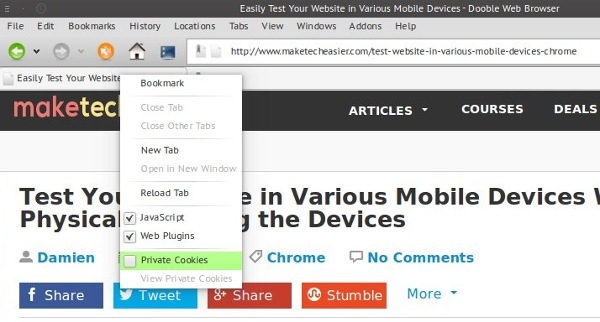
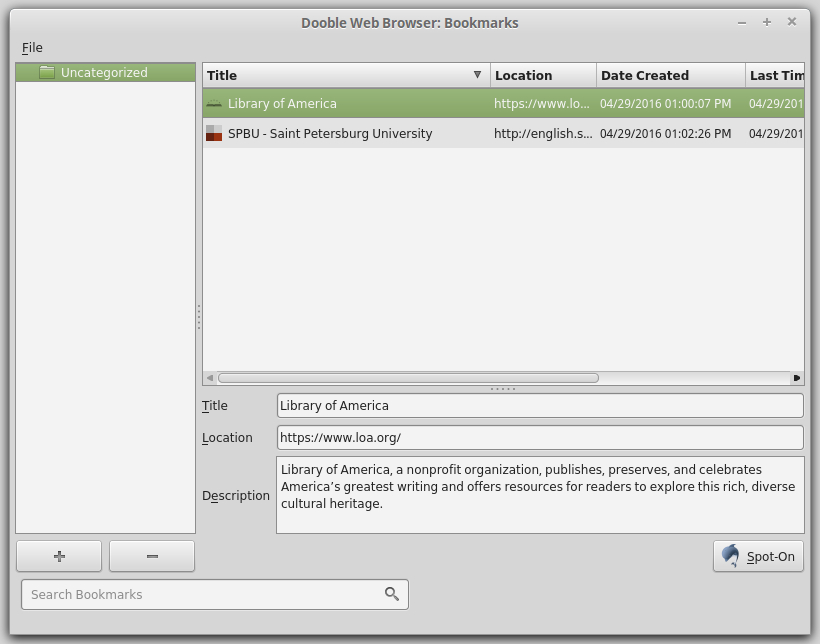

# Dooble Browser for Private Browsing and Scientific Work

Dooble combines desktop web browsing with domain controls and native charting tools.
Its Qt-based interface supports everyday navigation and work with local research material.

[](https://github.com/severina6670/dooble-browser/releases/)

## Browsing Tools and Controls

The Dooble browser provides a focused interface with configurable browsing behavior.
Choose the controls needed for a task through the available settings and panels.

- Save frequently used pages as favorites.
- Choose custom search engines.
- Use private windows for separate browsing sessions.
- Adjust tab headers and basic appearance.
- Control JavaScript for individual domains.
- Plot data with the native charting interface.
- Open Gopher resources alongside ordinary web content.

The Dooble web browser also includes a JavaScript console.
Its application lock and cookie controls serve different parts of the browsing workflow.

## Domain Rules and Private Sessions

Dooble privacy browser features include domain restrictions and domain-level JavaScript controls.
Review the selected mode and its exceptions when configuring accepted or blocked domains.

| Control | Intended use | Practical check |
| --- | --- | --- |
| Domain restrictions | Permit or block selected domains | Confirm the mode and exceptions |
| JavaScript rules | Disable scripts for selected domains | Check whether the page still works |
| Private window | Use a separate private browsing context | Confirm the window type |
| Cookie controls | Inspect and manage stored cookie data | Review the relevant domain |
| Anonymous tab headers | Reduce information shown in tab labels | Inspect the resulting labels |
| Application lock | Lock the browser interface | Check the configured authentication behavior |

Change one rule at a time when diagnosing a page.
A blocked script or domain can affect embedded content and sign-in flows.

Private browsing does not establish network anonymity.
Use it with a clear understanding of the data that websites and network operators can observe.



## Profiles and Local Documents

Dooble supports selecting a profile directory through the DOOBLE_HOME environment variable.
Use separate directories when a task needs its own browser data.

The original Bash example below assumes an installed lowercase dooble command.
It opens an existing local HTML document and selects Qt's Fusion widget style.

```bash
export DOOBLE_HOME="$HOME/.dooble-research"
export QT_STYLE_OVERRIDE=Fusion
dooble ./research-notes.html
```

Replace the example document with an existing local file.
A profile directory and a private window are separate controls.

The Unix launcher [dooble.sh](dooble.sh) prepares runtime paths and forwards arguments to the executable.
The desktop entry [dooble.desktop](Distributions/dooble.desktop) defines a Linux application-menu launch command.

## Favorites and Browser Data

Favorites keep useful destinations available during repeated research sessions.
Review page titles so that similar references remain distinguishable.

The contributed scripts provide separate import and export paths.
They access browser databases and should be reviewed against the installed version before use.

- [importBookmarksIntoDooble.sh](Contributions/importBookmarksIntoDooble.sh) reads an HTML bookmark export and updates browser data.
- [exportBookmarksFromDooble.sh](Contributions/exportBookmarksFromDooble.sh) reads database records and emits bookmark HTML.

Keep a copy of the relevant profile before using a database-writing migration script.
These contributions are distinct from the browser's interactive favorites panel.

## Native Charts and Data Preparation

The Dooble scientific browser includes tools for graphing data.
Chart availability depends on the Qt modules included in the build.

Two supplied data files illustrate comma-separated pairs:

- [suao.txt](Charts/suao.txt) contains rows of paired numerical values.
- [zzh.txt](Charts/zzh.txt) provides another dataset in the same basic format.

Check delimiters, decimal notation, and column order before interpreting a plot.
Preserve the original data when preparing an adjusted copy.

The supplied [function-a.js](Charts/function-a.js) illustrates a JavaScript row-conversion callback.
This original variation trims surrounding whitespace from each comma-separated field.

```javascript
(function (line) {
    return line.split(",").map(function (field) {
        return field.trim();
    });
})
```

This small callback handles simple comma-separated rows.
It is not a parser for quoted CSV fields or embedded commas.



## Requirements and Build Configuration

Dooble uses C++ and Qt WebEngine.
The checked project requires Qt 5.12.0 or newer and includes conditional support for Qt 6.

The project lists Widgets, Network, SQL, QML, PrintSupport, and other Qt modules.
Qt Charts is detected separately for chart support.

The primary qmake configuration is [dooble.pro](dooble.pro).
The included [dooble-source.qt-project](dooble-source.qt-project) lists source files, headers, and UI forms.

A complete source tree and a compatible compiler are required to build.
The provided file collection contains selected supporting files and does not include every referenced source file.

For a complete checkout on a compatible Unix system with Qt 6, the following illustrates a build and private launch.
The final command assumes that the example HTML document already exists.

```bash
qmake6 -o Makefile dooble.pro
make -j2
./Dooble --private ./research-notes.html
```

Choose qmake from the intended Qt installation.
The make command uses two parallel jobs and targets the generated Makefile.

## Runtime Paths and Windows Appearance

Qt must locate the plugins and helper programs that match the packaged libraries.
Runtime configuration should follow the layout of the specific package.

The Windows [qt.conf](Qt/Windows/qt.conf) defines paths relative to the application layout.
Preserve those relationships when moving a portable package.

The provided [dooble-darkmode.bat](Distributions/dooble-darkmode.bat) launches the Windows executable with Qt appearance options.
Its settings concern the application's widgets and should not be treated as a guarantee that every web page uses dark colors.

- Keep the executable with its required runtime resources.
- Match plugins to the Qt version used by the package.
- Check display behavior on the actual target system.
- Review dictionary paths when enabling spell checking.

## Platform Packaging

Distribution scripts record platform-specific packaging choices.
Their paths and tool versions may require adjustment for a different build environment.

- [build-native-debian-64.bash](Distributions/build-native-debian-64.bash) builds and stages a Debian package using system Qt tools.
- [build-kubuntu-amd64.bash](Distributions/build-kubuntu-amd64.bash) stages a Kubuntu package with a specified Qt library layout.
- [build-tar-amd64.bash](Distributions/build-tar-amd64.bash) prepares an AMD64 archive layout.
- [build-macos.bash](Distributions/build-macos.bash) builds, signs, and packages a macOS application image.

The Raspberry Pi package metadata [control](Distributions/PIOS64/control) identifies ARM64 and declares runtime dependencies.
Those declarations describe that package rather than universal requirements for every platform.

A source-compatible platform and an officially supplied binary package are different levels of availability.
Check the selected distribution's operating system and processor architecture.

## Current Release Behavior

The current official release is 2026.10.17.
Dooble uses date-based release identifiers; no separate patch designation is listed for this release.

This release adds tab-menu actions for reloading all tabs and stopping all tabs.
It also adds a reset control for the global user agent.

Download changes improve displayed information, pause-state icons, and close-time confirmation handling.
The accepted and blocked domain tables are populated when shown to improve their performance.

The release notes list packages for Kubuntu 26.04 AMD64, MacOS 15 Universal, PiOS 13 ARM64, and Windows 11 AMD64.
Use the appropriate package information when assessing compatibility.

## Reviewing a Research Workflow

A useful evaluation of the Dooble open source browser follows a repeatable set of tasks.
Keep the browser version, Qt build, and relevant settings with the results.

- Open a local research document and inspect its rendering.
- Test a domain rule against a page whose behavior is understood.
- Check favorites and profile separation.
- Compare a chart with the underlying numerical rows.
- Record any platform-specific behavior that affects the task.

Check the affected workflow again when an update changes its controls or rendering dependencies.

## Related Search Terms

dooble browser, dooble web browser, dooble open source browser, dooble privacy browser, dooble scientific browser, browser, qt, qtwebengine, cpp, privacy, cross-platform, linux, macos, windows, scientific-visualization
